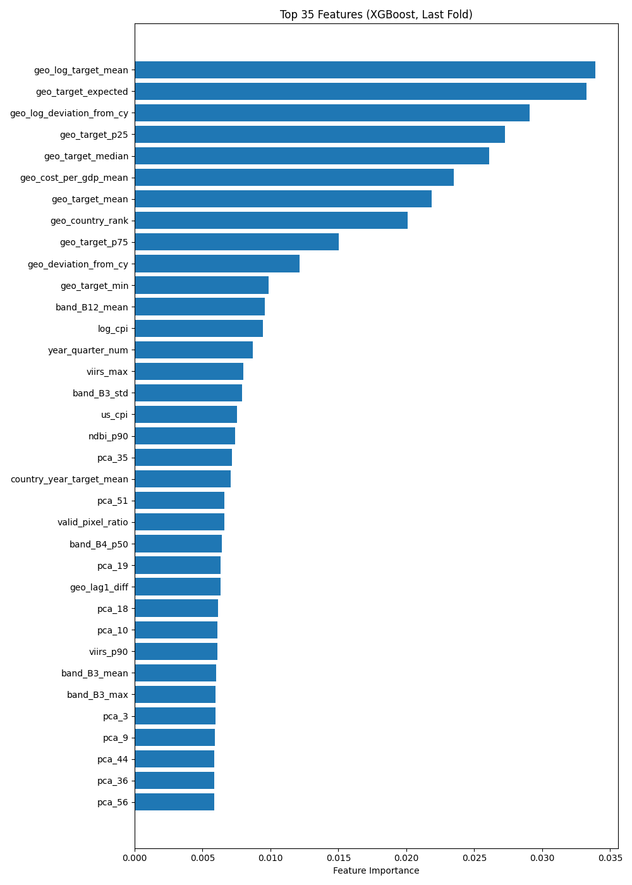

<h1 align="center">🏗️ Construction Cost Prediction</h1>

<p align="center">
  <a href="https://community.solafune.com/competitions/1918ccd7-eb06-4cfc-822f-a9823c63b2c1?menu=about&tab=overview"></a>
  
  
  
  
  <a href="LICENSE"></a>
</p>

<p align="center">
  <a href="#results"><b>Results</b></a> &nbsp;·&nbsp;
  <a href="#approach"><b>Approach</b></a> &nbsp;·&nbsp;
  <a href="#why-i-stopped-submitting"><b>Why I stopped</b></a> &nbsp;·&nbsp;
  <a href="#lessons"><b>Lessons</b></a> &nbsp;·&nbsp;
  <a href="#quickstart"><b>Quickstart</b></a> &nbsp;·&nbsp;
  <a href="docs/USAGE.md"><b>Full usage guide</b></a>
</p>

---

My solution to Solafune's [**Construction Cost Prediction**](https://community.solafune.com/competitions/1918ccd7-eb06-4cfc-822f-a9823c63b2c1?menu=about&tab=overview) challenge (ended March 2026): estimate the **construction cost per square meter (USD)** for regions of **Japan and the Philippines**, using economic indicators, geographic context and quarterly satellite composites.

I tried two routes: an **AutoGluon** model on the tabular data alone, and a more involved pipeline with **Prithvi EO 2.0** satellite embeddings, image statistics and country-specific gradient-boosted trees. The simpler route scored better. \
I finished **21st of 116 ranked teams** on the private leaderboard with an RMSLE of **0.1854** from six submissions, earning a silver badge.

## The challenge

Each row is one region and quarter between 2019 and 2024. The features are:

- **Tabular:** GDP, CPI, development and income classification, access to airports, ports, highways and railways, distance to the capital, and seismic, flood, cyclone and climate categories.
- **Sentinel-2 L2A:** a cloud-masked 12-band median composite per quarter, clipped to the region with GAUL 2024 boundaries.
- **VIIRS:** a quarterly median composite of nighttime lights (one `avg_rad` band).

Scoring is **RMSLE** (lower is better). The public leaderboard used about 35 % of the evaluation data, and the private leaderboard, which decides the final ranking, used all of it. The target comes from Japan's [Statistical Survey of Construction Starts](https://www.e-stat.go.jp/stat-search/files?page=1&toukei=00600120&tstat=000001016965) and the Philippine Statistics Authority's [building-permit statistics](https://openstat.psa.gov.ph/PXWeb/pxweb/en/DB/DB__2G__CONS__BGP/0012G4CBPC0.px/), modified for the challenge.

## Results

| Approach | Private RMSLE |
|---|:---:|
| AutoGluon on the tabular data | **0.185** |
| Prithvi embeddings + engineered features + boosted trees | 0.192 |

The exact best score (0.18540059576309284) and the rank come from the [private leaderboard](https://community.solafune.com/competitions/1918ccd7-eb06-4cfc-822f-a9823c63b2c1?menu=lb&tab=private). The per-approach scores are rounded figures from my project notes.

Adding satellite features made this a much richer experiment, but it didn't improve the private score in these runs. That's a result for these two implementations, not a verdict on satellite imagery.

## Approach

Both routes train on `log1p(target)` with an RMSE objective, so that minimizing the loss matches RMSLE, and convert predictions back to USD/m² with `expm1`.

<table>
  <tr>
    <th width="50%">📊 Route 1: AutoGluon (tabular only)</th>
    <th width="50%">🛰️ Route 2: Satellite features + boosted trees</th>
  </tr>
  <tr valign="top">
    <td>

- **Script:** [`solution_autogluon.py`](solution_autogluon.py)
- **Input:** the competition CSVs only, no imagery
- **Model:** `TabularPredictor`, `extreme` preset
- **Ensembling:** 5-fold bagging, 1 stacking level
- **Budget:** 1 h in the script, 2 h in my final run
- **Final ensemble:** weighted mix of TabM, TabDPT and RealTabPFN-v2
- **Hardware:** Google Colab, T4 GPU

</td>
    <td>

- **Scripts:** [`extract_features.py`](extract_features.py) → [`train_model.py`](train_model.py) → [`generate_submission.py`](generate_submission.py)
- **Embeddings:** Prithvi EO 2.0 300M TL on 6 Sentinel-2 bands, pooled to 1,024 dims, then PCA to 64
- **Image statistics:** NDVI, NDBI and NDWI, band summaries, valid-pixel ratio, VIIRS radiance
- **Context:** regional target aggregates, economic and hazard interactions, time features, spatial neighbors
- **Models:** XGBoost, LightGBM and CatBoost, trained separately for each country
- **Blend:** fold-averaged, with weights tuned on out-of-fold predictions

</td>
  </tr>
</table>

An earlier AutoGluon run stacked more classic learners (LightGBM, CatBoost, XGBoost, random forests, extra trees and neural nets). The leaderboard keeps only the best score, so I can't say which of the two AutoGluon runs produced the 0.185.

<details>
<summary><b>Route 2: out-of-fold scores and feature importance</b></summary>

<br>

| Model | OOF RMSLE | Blend weight |
|---|:---:|:---:|
| XGBoost | 0.2032 | 0.00 |
| LightGBM | 0.2021 | 0.43 |
| CatBoost | 0.2017 | 0.57 |
| **Weighted blend** | **0.2013** | — |

These are development estimates, not a clean held-out test. The folds shuffle rows within each country, so they don't hold out whole regions or future quarters. PCA is fitted before the split, and the blend weights are chosen on the same OOF predictions shown here.

<p align="center">
  
</p>

The plot comes from the last XGBoost fold of the last country, not from the whole ensemble. It shows how much that model leaned on regional target aggregates.

</details>

## Why I stopped submitting

During the competition, the forum pointed out that the target could be derived from the government statistics linked on the official overview page. The private leaderboard reflects this: the top four scores are effectively zero (about 2–3 × 10⁻¹⁶).

I was there to build a prediction model, so at that point I stopped competing. This repo keeps the modeling-based submissions I made before then. It doesn't reconstruct the target from those sources.

## Lessons

- 📏 **Keep a strong tabular baseline.** A tuned AutoML run on the CSVs beat a pipeline built around a 300M-parameter foundation model, image statistics and hand-built features.
- 🛰️ **More inputs isn't the same as more signal.** With about a thousand training rows, the 1,024-dimensional embeddings had to be cut to 64 PCA components. In the saved importance plot, regional target aggregates still dominate.
- 🧪 **Know what your validation measures.** Shuffled folds within each country test unseen rows, not unseen regions or future quarters, and the blend weights were tuned on the same OOF predictions. Treat those scores as development estimates.

## Quickstart

> [!IMPORTANT]
> **The competition data is not included.** Under the competition terms it is distributed only by Solafune and must be deleted after the competition. As the competition rules require, the following statement applies to the data and content provided by Solafune:
>
> cf. @solafune(https://solafune.com) Use for any purpose other than participation in the competition or commercial use is prohibited. If you would like to use them for any of the above purposes, please contact us.

**1. Lay out the data** like this (route 1 only needs the CSVs):

```
data/
├── train_dataset/
│   ├── train_tabular.csv
│   └── train_composite/                 # Sentinel-2 and VIIRS GeoTIFFs
├── evaluation_dataset/
│   ├── evaluation_tabular_no_target.csv
│   └── evaluation_composite/
└── sample_submission.csv
```

**2. Run route 1**, the AutoGluon model, from the repository root:

```bash
python -m pip install "autogluon[tabarena]==1.5.0"
```
```bash
python solution_autogluon.py             # → submission_autogluon_extreme.csv
```

**3. Run route 2**, the satellite pipeline. First download [Prithvi-EO-2.0-300M-TL](https://huggingface.co/ibm-nasa-geospatial/Prithvi-EO-2.0-300M-TL) (it includes the checkpoint and `prithvi_mae.py`) into `models/Prithvi-EO-2.0-300M-TL/`:

```bash
python extract_features.py --split train --data_root ./data --models_root ./models
python extract_features.py --split eval  --data_root ./data --models_root ./models
python train_model.py --data_root ./data --pca_components 64 --n_folds 5 --seed 42 --models xgb,lgb,catboost
python generate_submission.py --data_root ./data --output submission.csv
```

The [usage guide](docs/USAGE.md) covers dependencies, every output file and the caveats of each step.

<details>
<summary><b>Environment and reproducibility notes</b></summary>

<br>

| Component | Version |
|---|---|
| Platform | Google Colab, single T4 GPU |
| Python | 3.12 |
| AutoGluon | 1.5.0 with the `tabarena` extra |
| Route 2 packages | not recorded (see the [usage guide](docs/USAGE.md#satellite-features--ensemble)) |

- The `extreme` preset fits models under a time budget, so the chosen models and scores change with hardware and run length.
- Some of the preset's foundation models download gated weights from Hugging Face. In my run, a TabPFN-2.5 configuration failed and AutoGluon skipped it.
- Feature extraction falls back to random Prithvi weights if the checkpoint is missing, and fills unreadable images with zeros. Check the logs.

</details>

## Repository layout

```
.
├── solution_autogluon.py      # route 1: AutoGluon on the tabular data
├── extract_features.py        # route 2: Prithvi embeddings + image statistics
├── train_model.py             # route 2: per-country XGBoost / LightGBM / CatBoost
├── generate_submission.py     # route 2: fold-averaged, weighted inference
├── feature_importance.png     # XGBoost diagnostic from one fold
├── docs/
│   └── USAGE.md               # setup, commands, outputs and caveats
└── LICENSE  ·  NOTICE
```

## License

The code in this repository is licensed under the [Apache License 2.0](LICENSE), © 2026 Pranay Vandanapu (see [NOTICE](NOTICE)).

The license covers the code only. It does not cover the competition data or other content provided by Solafune, which is not included here and may not be redistributed. The Prithvi weights and the AutoGluon models' pretrained weights are downloaded separately and remain under their own licenses.

## Acknowledgements

Thanks to [Solafune](https://solafune.com/) for hosting the competition and providing the dataset. The imagery comes from Copernicus Sentinel-2 and NASA/NOAA VIIRS. Route 1 is built on [AutoGluon](https://github.com/autogluon/autogluon), and route 2 on IBM and NASA's [Prithvi EO 2.0](https://huggingface.co/ibm-nasa-geospatial/Prithvi-EO-2.0-300M-TL), [XGBoost](https://github.com/dmlc/xgboost), [LightGBM](https://github.com/microsoft/LightGBM) and [CatBoost](https://github.com/catboost/catboost).
